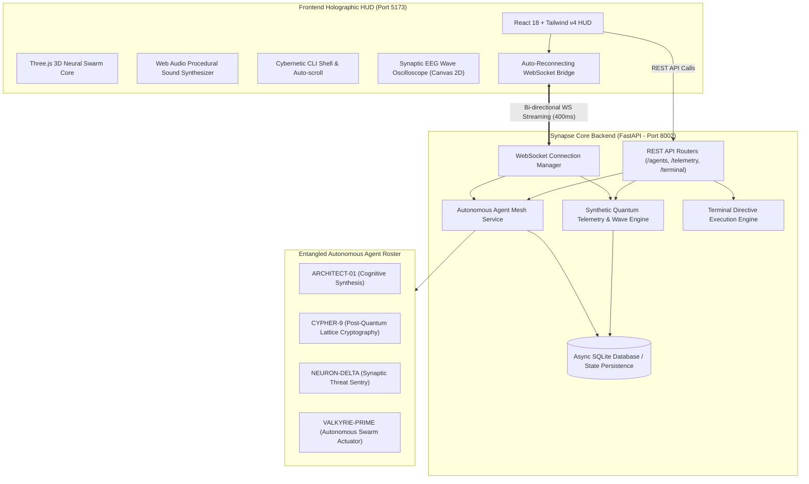

# ⟡ SYNAPSE-OS // QUANTUM MESH ⟡
### Neural-Digital Interface & Autonomous AI Agent Mesh Command Center


---

## 🌟 Executive Overview

**SYNAPSE-OS** is an ultra-futuristic, production-grade command platform engineered for orchestrating autonomous AI agent swarms and monitoring high-dimensional quantum neural telemetry in real time. 

Built with an electric cyberpunk aesthetic, glassmorphic HUD design, and full-stack real-time streaming, SYNAPSE-OS delivers a 60fps WebGL holographic neural core, bi-directional WebSocket telemetry channels, procedural Web Audio synthesis, and an interactive cybernetic CLI terminal.

---

## 🏛 System Architecture



---

## ⚡ Core Features

### 1. 3D WebGL Neural Core Hologram (`Three.js`)
- **Particle Swarm & Synaptic Filaments**: 220 individual neural node particles distributed in a dual-hemisphere matrix connected by dynamic Euclidean synaptic filaments.
- **Dynamic Physics & Lighting**: Rotates interactively with cursor tracking and pulse rate tied to neural computation loads.
- **Quantum State Responsive**: Color shifts dynamically between Electric Cyan (Nominal), Neon Ultraviolet (Overclocked), and Alert Crimson (Decoherence Spikes).

### 2. Autonomous Multi-Agent Mesh & Swarm Router
- **ARCHITECT-01**: Supervises global neural topology convergence and neuro-symbolic reasoning.
- **CYPHER-9**: Specializes in post-quantum lattice cryptography, Bell-state verification, and zero-knowledge proofs.
- **NEURON-DELTA**: Synaptic threat & telemetry sentry executing anomaly isolation and adaptive firewalling.
- **VALKYRIE-PRIME**: Autonomous swarm actuator handling parallel sub-agent synthesis and rapid triage.
- **Intelligent Prompt Router**: Automatically routes directives to the best agent or lowest-load node.
- **4-Stage Cognitive Pipeline**: Real-time streaming phases (`COGNITIVE_INGESTION` ➔ `QUANTUM_CONSENSUS` ➔ `NEURAL_SYNTHESIS` ➔ `FINAL_VERIFICATION`).

### 3. Real-Time Quantum Telemetry & Oscilloscope
- **Multi-Wave Synthesis**: 60fps trigonometric generation of Alpha (8-12 Hz), Beta (13-30 Hz), and Gamma (30-100 Hz) brainwaves rendered on HTML5 2D Canvas.
- **Metric Gauges**: Tracks Quantum Coherence (%), Entanglement Stability (%), Synaptic Flux (GHz), and Anomaly Deviations ($\sigma$).
- **Dynamic Anomaly Containment**: Automated warning drawer when decoherence anomalies are injected, with one-click containment protocols.

### 4. Interactive Cybernetic Command Terminal
- Embedded terminal console supporting command history (Up/Down arrows), quick action shortcuts, and execution of system commands:
  - `status`: Full system diagnostics and quantum telemetry report
  - `agents`: Tabular display of node status, neural load, coherence, and temperature
  - `dispatch <agent|auto> <directive>`: Assign tasks directly to the swarm
  - `calibrate`: Lock quantum phase and realign qubits (with celebratory visual particle burst)
  - `anomaly [type] [severity]`: Inject test quantum decoherence spikes
  - `overclock`: Toggle high-throughput neural clocking mode
  - `reboot <agent_id>`: Cold-reboot a neural node
  - `matrix`: Display neural lattice topological map

### 5. Procedural Web Audio Sound Synthesizer
- Built using native Web Audio API with zero external media files.
- Generates procedural dual-sine dispatch chimes, sci-fi interface clicks, anomaly sirens, and harmonic calibration chords.
- Persistent master mute toggle and volume normalization.

---

## 🚀 Quick Start (Development & Production)

### Option 1: One-Click PowerShell Launcher
```powershell
.\start.ps1
```
*This automatically launches both backend and frontend, tests connectivity, and opens your browser to `http://localhost:5173`.*

---

### Option 2: Manual Start

#### Backend Setup
```powershell
cd backend
.venv\Scripts\Activate.ps1
python run.py
```
*Backend runs on `http://127.0.0.1:8002` with interactive OpenAPI docs at `http://127.0.0.1:8002/docs`.*

#### Frontend Setup
```powershell
cd frontend
npm run dev
```
*Frontend runs on `http://localhost:5173`.*

---

### Option 3: Docker Compose
```bash
docker-compose up --build
```

---

## 🧪 Automated Test Suite

Run backend test suite with full integration validation:
```powershell
cd backend
.venv\Scripts\pytest app\tests -v
```
All tests validate:
- System health and root endpoints
- Multi-agent registry and status
- Task dispatching and heuristic routing
- Quantum telemetry generation and calibration
- Cybernetic terminal command execution

---

## 📡 REST API & WebSocket Reference

### REST Endpoints
| Method | Endpoint | Description |
|---|---|---|
| `GET` | `/health` | Healthcheck and active agent count |
| `GET` | `/api/agents` | List all 4 autonomous agent nodes |
| `GET` | `/api/agents/{id}` | Retrieve individual agent state |
| `POST` | `/api/agents/dispatch` | Dispatch mission directive to agent mesh |
| `POST` | `/api/agents/{id}/reboot`| Cold-reboot specific agent node |
| `GET` | `/api/agents/tasks/recent`| Retrieve recent tasks and reasoning logs |
| `GET` | `/api/telemetry/current` | Current quantum and EEG wave metrics |
| `POST` | `/api/telemetry/calibrate`| Realign quantum phase and coherence |
| `POST` | `/api/telemetry/anomaly` | Trigger test anomaly event |
| `POST` | `/api/telemetry/overclock`| Toggle high-throughput clocking |
| `POST` | `/api/terminal/execute` | Execute CLI command string |

### WebSocket Endpoint (`/ws`)
- **Connect**: `ws://localhost:8002/ws`
- **Outgoing Streams**:
  - `TELEMETRY_UPDATE` (every 400ms)
  - `AGENT_STATE_UPDATE` (on state changes)
  - `TASK_DISPATCHED`, `TASK_STEP`, `TASK_COMPLETED`
  - `QUANTUM_CALIBRATED`, `ANOMALY_TRIGGERED`, `OVERCLOCK_TOGGLED`
  - `TERMINAL_EVENT`
- **Incoming Directives**:
  - `PING` / `PONG` (active latency measuring)
  - `DISPATCH_TASK`, `CALIBRATE`, `EXECUTE_COMMAND`, `TRIGGER_ANOMALY`, `TOGGLE_OVERCLOCK`

---

## 🛡 License
MIT License. Built for production grade autonomous mission control.
